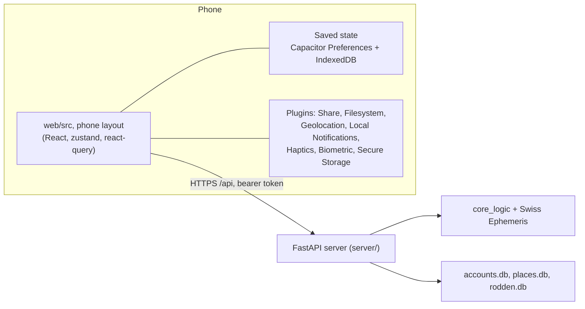
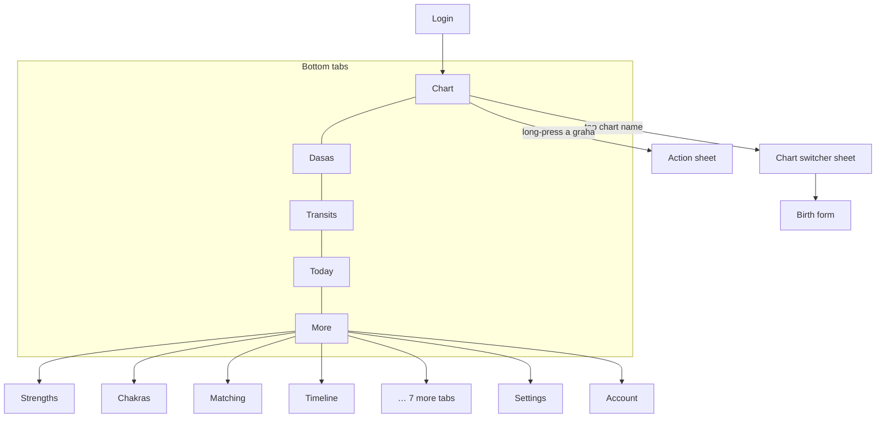

# Sudarshana Mobile: how the web app becomes a phone app

This is the plan for an iOS and Android app with every feature of the web app ([FEATURE_MAP.md](FEATURE_MAP.md) lists
them one by one). The screens are drawn in [wireframes.html](wireframes.html).

## 1. What changes on a phone

The web app is built for a wide screen, a mouse and a keyboard. On a phone, five things are different, and every
decision below follows from one of them:

1. **One column.** Starlight's charts-left, tab-right layout becomes chart-on-top, tab-below, one screen at a time.
2. **No right-click, no hover, no shortcuts.** Context menus become long-press action sheets; Ctrl+Tab becomes a
   swipe. The app already has no hover hints (a standing rule), so nothing is lost there.
3. **Fingers, not a pointer.** Every target is at least 44 × 44 pt, including the grahas inside a chart.
4. **The network comes and goes.** Results the server computed are kept on the phone and shown at once, then
   refreshed.
5. **The phone has more.** A share sheet that attaches files, location, notifications, widgets and biometrics.

## 2. Platform: one codebase, packaged with Capacitor

Three ways to get Sudarshana onto phones:

| | Installable web app (PWA) | Capacitor app over the web code | React Native rewrite |
|---|---|---|---|
| Reuses `web/src` | All of it | All of it, with a phone layout | Types, API client, store and pure math only; every screen redrawn |
| Chart drawing | Same SVG | Same SVG (`renderChart.tsx`, `SouthGrid.tsx`, `Wheels.tsx`) | Ported to `react-native-svg` |
| App Store / Play Store | No (Android only, via the browser) | Yes | Yes |
| Share files, notifications, widgets, biometrics | Partly | Yes, through plugins | Yes |
| Size of the job | Small | Medium | Large: about 14,000 lines of screens to redo |
| Feel | Web | Near-native with care (gestures, sheets, haptics) | Native |

**Recommendation: Capacitor.** Sudarshana's value is its depth: 17 tabs, about 60 sub tabs, many dasa systems and
chakras. A rewrite would spend months recreating screens that already work. With Capacitor:

- the phone layout is a **third arrangement of the Starlight theme** in the same `web/src`, chosen automatically below
  600 px wide, so every fix lands on the web and on phones at once;
- the Windows layout stays desktop-only, as CLAUDE.md asks ("Windows: leave as is");
- native features come from plugins, not native screens;
- if one screen ever needs native speed (the astrocartography map, say), it can be replaced alone later.

The phone layout works in a mobile browser first (phase 1), so it can be checked at 127.0.0.1:8000 on a phone before
anything is packaged.

## 3. Architecture

- **The server stays the engine.** Every number on the phone comes from the same `/api` routes as the web, so the
  server tests keep covering the phone too. Nothing astrological is computed twice.
- **The web build is bundled into the app** (`web/dist` copied by `npx cap sync`), not loaded from the server's URL.
  The app starts without a network round trip and passes App Store review, which turns away apps that only wrap a
  website.
- **Requests carry the user's settings**, as they do now: `api.ts` already sends `{ settings, ...body }` with every
  POST, so the phone shows the same results as the web for the same options.

### What the server needs first (phase 0)

| Change | Where | Why |
|---|---|---|
| A hosted server with a fixed address | `docs/SECURITY.md` "before the cloud" | Phones can't reach 127.0.0.1; the Cloudflare quick tunnel changes address on every start |
| Bearer tokens beside the cookie | `server/auth.py` | The bundled app's origin (`capacitor://localhost` on iOS, `https://localhost` on Android) is not the server's, so cookies would need `SameSite=None`; a token in the platform keychain is simpler and safer |
| CORS for the two app origins only | `server/app/main.py` | The browser in the app checks it |
| `ALLOWED_HOSTS` and the CSP | `server/app/main.py` (`HEADERS`) | The app's own CSP goes in its `index.html` meta; the server's keeps protecting the web |
| Provider sign-in returning to the app | `server/auth.py` OAuth callback | Redirect to `sudarshana://auth?code=…`, opened by the system browser session |
| Smaller list responses | `/api/rodden`, `/api/mundane/data/*` | Already gzipped; add paging so a phone doesn't take the whole library at once |

## 4. Navigation

Five bottom tabs, with the chart's name always in the header:

| Tab | Holds | Why it's in the bar |
|---|---|---|
| **Chart** | Home: Overview, Grahas, Bhavas, Aspects, Yogas, KP, Amsas, Speeds, Key Info, Options | Opened every session |
| **Dasas** | All dasa systems, opening on the running period | The second thing everyone checks |
| **Transits** | Transits, Calendar strip, Tajaka, Tithi Pravesha, searches, progressions, prasna, Laghu Parasari | Daily use; one home for everything about time moving |
| **Today** | Panchanga, muhurta finder, festivals | Daily use, and needs no chart |
| **More** | A grid of the other eleven tabs, plus Settings, Account, Help, About | Everything else, two taps away |

- **Pin to the bar.** Long-press a tile in More to swap it into the bar in place of Transits or Today. The choice is
  kept like any other view state.
- **Sub tabs** are a horizontal chip row under the header. Following the web's rule, the row never moves: it sits
  between the fixed header and a separate scrolling area, not `position: sticky`. Swiping the content sideways moves to
  the next chip.
- **The header** holds no heading repeating the tab name, only the chart switcher, the clock chip (time stepping and
  modes) and the ⋯ menu.
- **Back** closes the top sheet or modal first, then returns to the previous tab (Android back button and the iOS
  edge swipe).

## 5. From desktop interaction to touch

| On the web | On the phone |
|---|---|
| Right-click menu on a graha, a house, a dasa row (`Menu.tsx`) | Long-press opens an action sheet with the same items, with a light haptic tick |
| Hover highlight in purple to show something is clickable | Pressed state in purple; the item looks tappable at rest |
| Ctrl+Tab between page tabs | Swipe between sub tabs; the bottom bar between tabs |
| Several windows side by side (`Windows.tsx`) | A stack of full-screen modals with back |
| Wide tables | One card per row with its key columns, tap to expand; no sideways scrolling, as in the Starlight right half |
| Dialogs (birth data, settings, print) | Full-screen forms or bottom sheets |
| Copy text to the clipboard | Share sheet (copy is one of its actions) |
| Download a file, `mailto:` with the chart pasted in | Share sheet with the file attached |
| Browser print | PDF on the phone, then the share sheet (print is in it) |
| Typing a place | Place search, or "Here" from location |

## 6. Components

The phone layout reuses `web/src/ui.tsx`, `hooks.ts` and `format.ts`, as CLAUDE.md asks, and adds only what touch
needs.

| Component | From | What it does on the phone |
|---|---|---|
| `ChipTabs` | `SubTabs` (`ui.tsx`) | The fixed sub tab row: scrolls sideways itself when the chips don't fit, the active chip in gold |
| `BottomBar` | new | Five tabs; the active one in gold, icons and short labels |
| `ChartSwitcher` | `OpenChart.tsx` | Sheet listing charts by source, with search and New chart |
| `ChartCard` | `ChartPane.tsx`, `renderChart.tsx` | The chart in the chosen style, full width, square; varga chip; tap a graha for details, long-press for actions |
| `BottomSheet` | new | One sheet component for pickers, details, filters and action lists; drag to dismiss |
| `ActionSheet` | `Menu.tsx` | The context menu's items as a sheet |
| `DataCards` | the tables in `Strengths.tsx`, `Views.tsx` and others | A row of a table as a card: name, the two or three key values, the rest on expand |
| `NestedPeriods` | the dasa table in `Dasas.tsx` | Mahadasa › antardasa › pratyantar, opening on today, "now" in gold |
| `TimeStrip` | the Transit Calendar strip | Rows per graha, coloured spans, panned through time with a finger |
| `ZoomCanvas` | `Wheels.tsx`, `Chakras.tsx`, the ashtakavarga grid, the map | Pinch and pan with limits and a reset button |
| `PlaceSearch` | `BirthDialog.tsx`, `Muhurta.tsx` | Search with country and state, each result showing its height; "Here" with location |
| `DateTimeWheels` | `BirthDialog.tsx` | Native date and time pickers, seconds included, with Julian and Gregorian |
| `SettingsList` | `Settings.tsx`, `StarSettings.tsx` | Generated from `/api/settings/schema` like the web; grouped, searchable |
| `ShareButton` | `CopyButton` (`ui.tsx`) | Opens the share sheet with text or a file |
| `Loaded` | `ui.tsx` | Same loading and error states, sized for the phone; a cached result shows at once with a quiet "updating" mark |
| `OfflineBar` | new | A thin bar saying results are from the last connection |

## 7. State: nothing disappears

The web's rule is that a reload reopens exactly what was on screen. On a phone the equivalent is the system killing the
app in the background, and the rule holds there too.

- `useKept` and `useSaved` (`hooks.ts`) and the chart store (`store.ts`) write to `localStorage`. iOS can clear a web
  view's storage when space runs low, so in the app these go through **Capacitor Preferences**, which is permanent.
  A small adapter keeps the same hook names.
- The tab, sub tab, open sheet or modal, form inputs and scroll position of each tab are all kept.
- **Computed results** (react-query) are saved to IndexedDB and keyed by birth and settings, as the query keys are now.
  Opening a chart shows its last results at once, even with no connection.
- **Charts** stay local first, as on the web, and sync with the account's cloud charts (`/api/auth/charts`).

## 8. Native features

| Feature | Plugin | Notes |
|---|---|---|
| Share text, PDFs and chart files | `@capacitor/share`, `@capacitor/filesystem` | Replaces the download and mailto workarounds |
| Import `.jhd`, `.vs` and `.ini` | File picker plugin | Also "Open in Sudarshana" from Files and mail attachments |
| "Now, here" chart | `@capacitor/geolocation` | Asked for only when tapped; the place's height comes from `places.db` |
| Reminders | `@capacitor/local-notifications` | Scheduled on the phone from times the server already returns (muhurta windows, dasa starts, sign changes); no push server needed |
| Haptics | `@capacitor/haptics` | On a long-press and a chip change, nothing else |
| App lock | Biometric plugin | Optional, in Settings |
| Session token | Secure storage plugin | Keychain on iOS, Keystore on Android |
| Shared chart links | App links / universal links | `https://<host>/shared/<id>` opens in the app |
| Widget | Native code (WidgetKit, Glance) | Phase 4; reads a small summary the app saves after each refresh |

## 9. Security and privacy

- Birth data is personal. App Store privacy labels and the Play data safety form list it as "user content, linked to the
  user, not used for tracking".
- The owner's prefilled login is a 127.0.0.1 convenience only and is not built into the app.
- The token never goes into `localStorage`; sign out deletes it and calls `/api/auth/logout`.
- Every control in `docs/SECURITY.md` still applies to the hosted server. The checklist there is done before the first
  build goes to TestFlight or Play internal testing.

## 10. Look

The phone keeps Starlight's identity exactly ([wireframes.html](wireframes.html) uses these values):

| Role | Light | Dark |
|---|---|---|
| Background | `#ffffff` | `#0a0a0a` |
| Ink | `#0a0a0a` | `#f4f4f5` |
| What you act on (buttons, links, pressed states) | purple `#5b2bd9` | `#a68cff` |
| Where you are (active tab, chip, "now") | gold `#f5b03e` | `#ffc766` |
| Lines | `#e3e5e9` | `#232428` |

- Solid colours only, no gradients, no cream.
- Type: Eczar for the name and headings, IBM Plex Sans for text, IBM Plex Mono for degrees and dates, Tiro Devanagari
  Sanskrit for Devanagari.
- Grahas as capital + small: Su Mo Ma Me Ju Ve Sa Ra Ke. Where a colour already names an event, the label skips the
  event name.
- No visible scrollbars; everything still scrolls.
- No colour-scale legends beside tables.
- Sign-in: real NASA/Webb imagery full-bleed, no card around the form. The chakra intro plays before sign-in only;
  signing in is a short fade.
- Dynamic Type: text sizes follow the phone's setting; chart labels scale with the chart, not the text setting.

## 11. Accessibility

- Each graha in a chart is its own accessible element ("Saturn, 14° Capricorn, 10th bhava, retrograde").
- Colour never carries meaning alone: tones also have a word or a sign.
- The intro and transitions respect Reduce Motion.
- Contrast meets WCAG AA in both themes. The palette above already does for text on background.

## 12. Performance

- Split the code per tab with `import()`; today's build is one large chunk (Vite warns about it). The phone then loads
  Chart, Dasas and Today first.
- Large generated modules (`worldMap.ts`, `sky.ts`) and the Research datasets load only when their tab opens.
- Opening a chart prefetches Chart and Dasas; other tabs fetch when shown.
- Budgets: first chart on screen within 1.5 s on a mid-range Android phone with a warm cache, and 3 s cold.

## 13. Testing

- The server suites stay the source of truth for numbers (`core_logic/tests`, `server/tests`).
- `npm test` keeps covering the pure TypeScript (`chartGeometry`, `wheelGeometry`, `zones`, …).
- New: Playwright (already a dev dependency as `playwright-core`) runs the phone layout at 390 × 844 and 360 × 800 for
  the P0 journeys: sign in, open a chart, read the dasa, check today's panchanga, change a setting, restart and find
  everything where it was.
- Devices: an iPhone SE (smallest), a recent iPhone, a mid-range Android, an Android tablet.

## 14. Roadmap

| Phase | Ships | Done when |
|---|---|---|
| 0 Server | Hosted server, bearer tokens, CORS, OAuth redirect to the app, paged lists | The web app works against the hosted server, and a token client passes `server/tests` |
| 1 Phone layout | Starlight phone arrangement in `web/src`: bottom bar, chip rows, sheets, cards; all P0 rows of the feature map | Every P0 journey works in a phone browser at 127.0.0.1:8000 |
| 2 App | Capacitor shell, Preferences-backed state, share, files, location, haptics, secure token; store listings | TestFlight and Play internal test builds |
| 3 Depth | All P1 rows: Strengths, Chakras, Matching, Timeline, Predictions, Remedies, the other Transits views, reminders | Feature parity with the web for daily astrology |
| 4 Everything | All P2 rows: Research, Finance, Astrocartography, Mundane, Longevity, windows; widget; app lock | Every row in the feature map is on the phone |

## 15. Open questions for the owner

1. Which four tabs go in the bottom bar by default? The plan proposes Chart, Dasas, Transits, Today.
2. Is the hosted server one shared instance, or one per user? This affects sign-up and the accounts database
   (`docs/TODO.md`, "Before the cloud").
3. Tablets: the Starlight desktop layout fits an iPad in landscape. Should tablets get it rather than the phone layout?
4. Should reminders be on by default for the running dasa's changes, or opt-in only?
